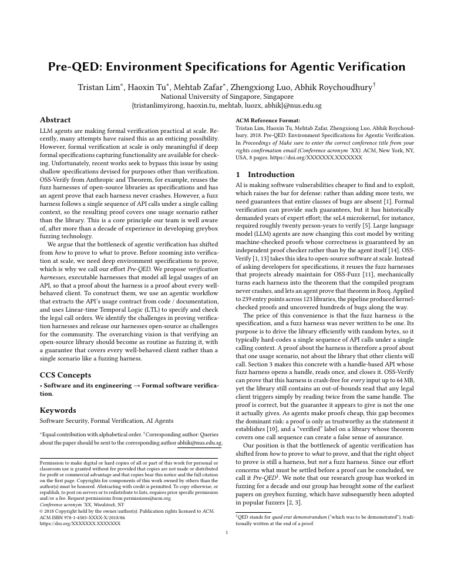

# Pre-QED: Environment Specifications for Agentic Verification

<p align="center">
  <a href="https://pre-qed.github.io/pre-qed.pdf">
    
  </a>
</p>
<p align="center">
  <a href="https://pre-qed.github.io/pre-qed.pdf"><strong>Read the paper</strong></a>
  ·
  <a href="https://pre-qed.github.io/"><strong>Project website</strong></a>
</p>

Verification harnesses for 29 open-source C/C++ libraries, designed to model legal API usages so that proving
properties of a harness establishes those properties for well-behaved clients within its modeled scope.
Each harness exposes one wrapper per API function. An LTL call filter, generated from the subject's
`ltl.json`, checks every call before it runs and skips calls that break a documented usage rule (use after free,
use before init, ...). Because the harnesses remain executable, libFuzzer can also drive them through varied
legal call sequences and calling contexts.

While building the harnesses we found real bugs in several libraries (each with a reproducer). Some harnesses
steer around these bugs; they will be updated once the fixes land upstream.

- [Subjects](#subjects)
- [Build](#build)
- [Run](#run)
- [Repository layout](#repository-layout)

## Subjects

| subject | library | commit | harness | API wrappers | LTL rules |
|---|---|---|---|---|---|
| [boost-beast](boost-beast/) | [github.com/boostorg/boost](https://github.com/boostorg/boost) | `4daa5786d7c5` | [harness.cpp](boost-beast/harness.cpp) | 475 | [16](boost-beast/ltl.json) |
| [boost-json](boost-json/) | [github.com/boostorg/boost](https://github.com/boostorg/boost) | `4daa5786d7c5` | [harness.cpp](boost-json/harness.cpp) | 171 | [4](boost-json/ltl.json) |
| [bzip2](bzip2/) | [sourceware.org/git/bzip2](https://sourceware.org/git/bzip2) | `f5dfc96063fe` | [harness.c](bzip2/harness.c) | 24 | [5](bzip2/ltl.json) |
| [cgif](cgif/) | [github.com/dloebl/cgif](https://github.com/dloebl/cgif) | `b1facf77a226` | [harness.c](cgif/harness.c) | 6 | [2](cgif/ltl.json) |
| [cjson](cjson/) | [github.com/DaveGamble/cJSON](https://github.com/DaveGamble/cJSON) | `acc76239bee0` | [harness.c](cjson/harness.c) | 92 | [5](cjson/ltl.json) |
| [coturn](coturn/) | [github.com/coturn/coturn](https://github.com/coturn/coturn) | `70ca74e0bd83` | [harness.c](coturn/harness.c) | 145 | [6](coturn/ltl.json) |
| [double-conversion](double-conversion/) | [github.com/google/double-conversion](https://github.com/google/double-conversion) | `2c1eb4ff0518` | [harness.cpp](double-conversion/harness.cpp) | 33 | [3](double-conversion/ltl.json) |
| [fast_float](fast_float/) | [github.com/fastfloat/fast_float](https://github.com/fastfloat/fast_float) | `a8a02f77480d` | [harness.cpp](fast_float/harness.cpp) | 36 | [0](fast_float/ltl.json) |
| [glaze](glaze/) | [github.com/stephenberry/glaze](https://github.com/stephenberry/glaze) | `dce5e0f7ec57` | [harness.cpp](glaze/harness.cpp) | 267 | [5](glaze/ltl.json) |
| [json-c](json-c/) | [github.com/json-c/json-c](https://github.com/json-c/json-c) | `d17ad9d1863e` | [harness.c](json-c/harness.c) | 117 | [8](json-c/ltl.json) |
| [jsoncons](jsoncons/) | [github.com/danielaparker/jsoncons](https://github.com/danielaparker/jsoncons) | `af497a1c1ea9` | [harness.cpp](jsoncons/harness.cpp) | 447 | [10](jsoncons/ltl.json) |
| [leptonica](leptonica/) | [github.com/DanBloomberg/leptonica](https://github.com/DanBloomberg/leptonica) | `10bdea2f1924` | [harness.c](leptonica/harness.c) | 2665 | [2](leptonica/ltl.json) |
| [libdiginet](libdiginet/) | [github.com/FreeMixer/libdiginet](https://github.com/FreeMixer/libdiginet) | `835f336ccb7a` | [harness.c](libdiginet/harness.c) | 53 | [5](libdiginet/ltl.json) |
| [libpcap](libpcap/) | [github.com/the-tcpdump-group/libpcap](https://github.com/the-tcpdump-group/libpcap) | `7fc0bcd48aee` | [harness.c](libpcap/harness.c) | 89 | [4](libpcap/ltl.json) |
| [libreac](libreac/) | [github.com/FreeREAC/libreac](https://github.com/FreeREAC/libreac) | `d16f3f4eba60` | [harness.c](libreac/harness.c) | 415 | [33](libreac/ltl.json) |
| [msgpack-c](msgpack-c/) | [github.com/msgpack/msgpack-c](https://github.com/msgpack/msgpack-c) | `a5250ecbcae1` | [harness.cpp](msgpack-c/harness.cpp) | 152 | [11](msgpack-c/ltl.json) |
| [omx-clap-core](omx-clap-core/) | [github.com/FreeMixer/omx-clap-core](https://github.com/FreeMixer/omx-clap-core) | `246923f04ac0` | [harness.c](omx-clap-core/harness.c) | 103 | [7](omx-clap-core/ltl.json) |
| [plugin-hostd](plugin-hostd/) | [github.com/FreeMixer/plugin-hostd](https://github.com/FreeMixer/plugin-hostd) | `65cd2b02e830` | [harness.c](plugin-hostd/harness.c) | 27 | [1](plugin-hostd/ltl.json) |
| [pupnp](pupnp/) | [github.com/pupnp/pupnp](https://github.com/pupnp/pupnp) | `b46bc77ac9ae` | [harness.c](pupnp/harness.c) | 494 | [20](pupnp/ltl.json) |
| [reac-repacer](reac-repacer/) | [github.com/FreeREAC/reac-repacer](https://github.com/FreeREAC/reac-repacer) | `3ac1cf1017c8` | [harness.c](reac-repacer/harness.c) | 16 | [0](reac-repacer/ltl.json) |
| [simdjson](simdjson/) | [github.com/simdjson/simdjson](https://github.com/simdjson/simdjson) | `f807de973580` | [harness.cpp](simdjson/harness.cpp) | 453 | [15](simdjson/ltl.json) |
| [skcms](skcms/) | [skia.googlesource.com/skcms](https://skia.googlesource.com/skcms) | `9c10699e8884` | [harness.cpp](skcms/harness.cpp) | 38 | [2](skcms/ltl.json) |
| [speex](speex/) | [gitlab.xiph.org/xiph/speex](https://gitlab.xiph.org/xiph/speex) | `a1b872e6704c` | [harness.c](speex/harness.c) | 56 | [6](speex/ltl.json) |
| [spirv-tools](spirv-tools/) | [github.com/KhronosGroup/SPIRV-Tools](https://github.com/KhronosGroup/SPIRV-Tools) | `47c74f488bad` | [harness.cpp](spirv-tools/harness.cpp) | 162 | [18](spirv-tools/ltl.json) |
| [tinyobjloader](tinyobjloader/) | [github.com/tinyobjloader/tinyobjloader](https://github.com/tinyobjloader/tinyobjloader) | `45636bdcef1a` | [harness.cpp](tinyobjloader/harness.cpp) | 50 | [4](tinyobjloader/ltl.json) |
| [varnish](varnish/) | [github.com/varnishcache/varnish-cache](https://github.com/varnishcache/varnish-cache) | `bc9eaf713fe9` | [harness.c](varnish/harness.c) | 223 | [20](varnish/ltl.json) |
| [yajl-ruby](yajl-ruby/) | [github.com/brianmario/yajl-ruby](https://github.com/brianmario/yajl-ruby) | `6501652d1135` | [harness.c](yajl-ruby/harness.c) | 26 | [3](yajl-ruby/ltl.json) |
| [zlib](zlib/) | [github.com/madler/zlib](https://github.com/madler/zlib) | `51b7f2abdade` | [harness.c](zlib/harness.c) | 82 | [6](zlib/ltl.json) |
| [zstd](zstd/) | [github.com/facebook/zstd](https://github.com/facebook/zstd) | `82d322c4973d` | [harness.c](zstd/harness.c) | 167 | [13](zstd/ltl.json) |

## Build

```sh
docker build -t preqed-harness .
alias run='docker run --rm -u "$(id -u):$(id -g)" -e HOME=/work/work -v "$PWD":/work preqed-harness'
run scripts/fetch.sh all        # or: run scripts/fetch.sh cjson zlib
run scripts/build.sh all        # -> work/out/<subject>/fuzzer (ASan + UBSan + libFuzzer)
```

`fetch.sh` clones each library at its pinned commit into `work/src/` and copies the subject's `overlay/` in.
`build.sh` compiles `ltl.json` to the call filter, then the library sources, the filter and the harness into
`work/out/<subject>/fuzzer`. Both continue past a failing subject and list the failures at the end.
libdiginet, plugin-hostd and omx-clap-core are in private repositories.

## Run

```sh
docker run --rm --ulimit nofile=4096:4096 -u "$(id -u):$(id -g)" -v "$PWD":/work preqed-harness \
  work/out/cjson/fuzzer -max_total_time=60
```

pupnp runs the UPnP stack inside the fuzzer and needs a non-loopback interface:

```sh
docker network create --internal preqed-upnp
docker run --rm --network preqed-upnp --ulimit nofile=4096:4096 -u "$(id -u):$(id -g)" -v "$PWD":/work preqed-harness \
  work/out/pupnp/fuzzer -max_total_time=60
```

leptonica: `-e ASAN_OPTIONS=detect_leaks=0`.

## Repository layout

| path | contents |
|---|---|
| `<subject>/harness.c`, `harness.cpp` | the harness (`LLVMFuzzerTestOneInput`) |
| `<subject>/ltl.json` | the API usage rules: per rule an LTL `formula` over `call:<api>` / `ok:<api>` events, its `predicates`, the documented `rule` it encodes, and allowed/rejected `examples` |
| `<subject>/build.json` | compile settings: `languageStandard`, `includeRoots`, `preprocessorDefinitions`, `implementationSources`, `linkLibraries` |
| `<subject>/source.json` | the library's `repository` and pinned `commit`; optional `submodules` and `extra` repositories |
| `<subject>/overlay/` | files copied into the fetched tree (configure-time headers, generated tables) |
| `leptonica/gen_harness.py` | generates the leptonica harness |
| `tools/check-ltl.ts`, `tools/monitor.ts` | compile `ltl.json` to the call filter with Spot and replay every example |
| `scripts/fetch.sh`, `scripts/build.sh` | fetch the pinned sources; build the fuzzers |
| `Dockerfile` | the build environment: clang with libFuzzer, Spot, Node, and the system libraries some subjects link |
| `work/` | fetched sources and build output (not in the repository) |
